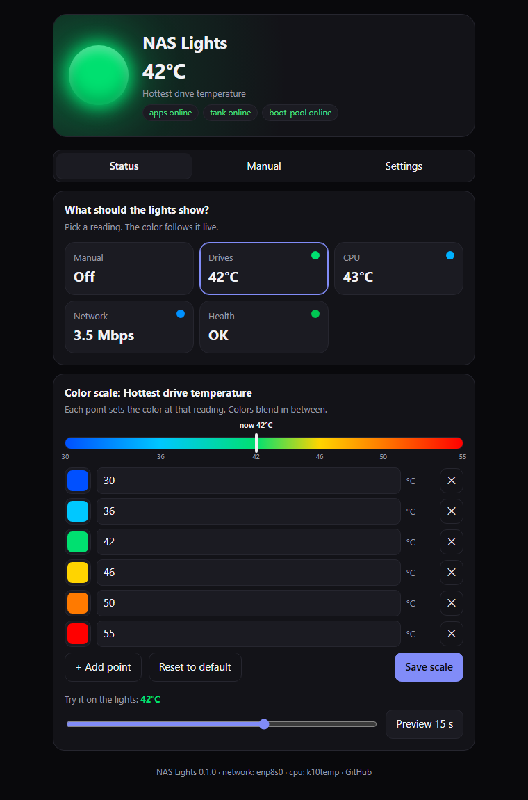
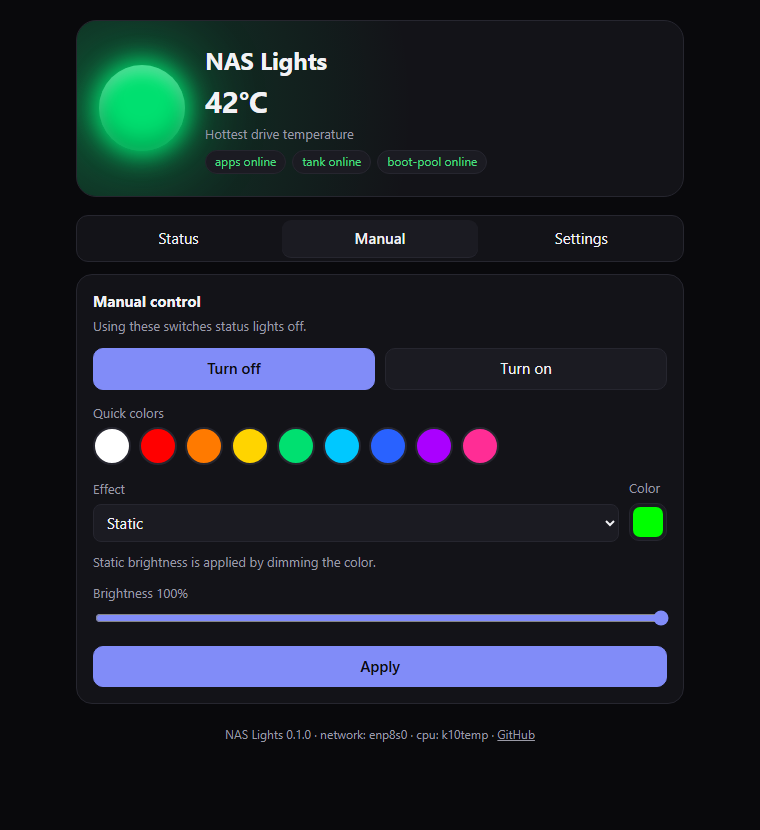
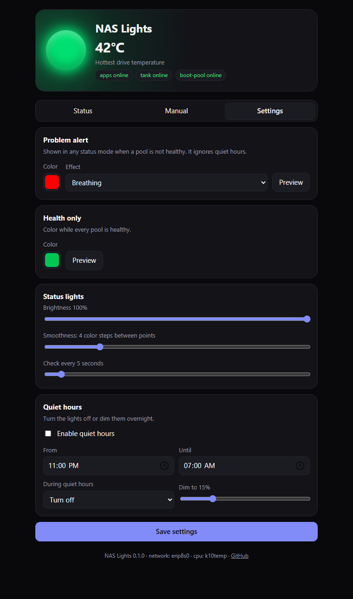
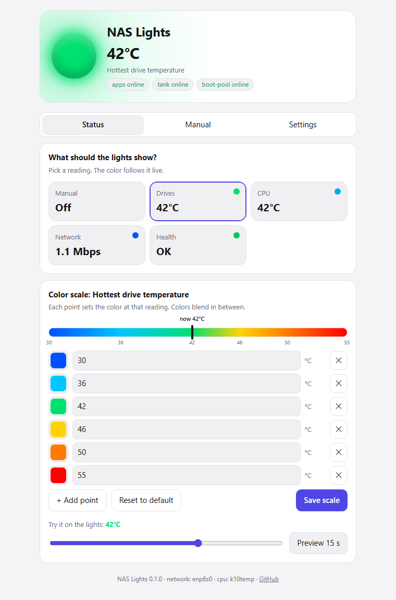

# NAS Lights

Turn the RGB lighting in your NAS into a status display. NAS Lights is a small web app that drives [OpenRGB](https://openrgb.org) and colors your case by what the server is doing: drive temperature, CPU temperature, network traffic, or ZFS pool health. If a pool degrades, the lights start breathing red.



## Features

- **Status lights.** Pick a reading and the color follows it live:
  - hottest drive temperature
  - CPU temperature
  - network throughput
  - ZFS health only
- **Editable color scales.** Each reading has its own scale of points, such as 30 °C blue, 42 °C green and 55 °C red. Add, remove and recolor points on a live gradient that marks the current reading.
- **Smooth, flicker-free changes.**
  - Colors fade into each other over an adjustable time instead of jumping.
  - Readings are smoothed, so a short burst of traffic doesn't flash the case red.
  - A small hysteresis band keeps a reading that sits on a color boundary from bouncing between two colors.
- **Try before you save.** Drag a slider to any reading and preview that color on the real lights for 15 seconds.
- **Problem alert.** Any ZFS pool that isn't `ONLINE` overrides the status color with an alert style you choose, even during quiet hours.
- **Quiet hours.** Turn the lights off or dim them overnight.
- **Manual control.**
  - Each effect shows only the controls your hardware supports: color, speed, direction and brightness.
  - Brightness works on controllers without hardware brightness, by scaling the color.
- **Survives restarts.** Your last setting is reapplied when NAS Lights starts and whenever the OpenRGB server comes back.
- **Lightweight.** Standard-library Python with no dependencies, one container and a single-page UI. Light and dark themes, phone friendly.

| Manual | Settings | Light theme |
|---|---|---|
|  |  |  |

## How it works

```
 ┌───────────────┐   OpenRGB SDK (TCP 6742)   ┌──────────────────┐   USB / SMBus   ┌──────────────┐
 │  NAS Lights   │ ─────────────────────────▶ │  OpenRGB server  │ ──────────────▶ │ RGB hardware │
 │  web UI :6780 │                            │  (headless)      │                 └──────────────┘
 └──────┬────────┘                            └──────────────────┘
        │ reads (read-only)
        ├─ /sys/class/hwmon     drive + CPU temperatures
        ├─ /sys/class/net       NIC byte counters
        └─ /proc/spl/kstat/zfs  pool states
```

NAS Lights talks to OpenRGB over its network SDK, so it doesn't need OpenRGB installed in its own container. It works with any reachable OpenRGB server, including one running as a container next to it, on the host, or on another machine.

## Requirements

- **An OpenRGB server**, version 1.0 or later recommended, reachable on its SDK port (6742 by default). This repo includes a headless server image in [`openrgb/`](openrgb/Dockerfile) if you don't already have one.
- **Linux sensors** for the readings:
  - **Drive temperatures** need the `drivetemp` kernel module. TrueNAS SCALE loads it by default. Elsewhere, run `modprobe drivetemp`.
  - **CPU temperature** is detected automatically from `k10temp` (AMD), `zenpower`, `coretemp` (Intel) or `cpu_thermal` (ARM).
  - **Pool health** needs ZFS. Without ZFS, the other modes still work and Health shows "No pools".
- **Docker with Compose**, or anything that runs containers, such as a TrueNAS SCALE custom app.

## Quick start (Docker Compose)

```bash
git clone https://github.com/JohnLHolloway/nas-lights.git
cd nas-lights
docker compose up -d --build
```

Open `http://<your-nas>:6780`.

The example [`docker-compose.yml`](docker-compose.yml) starts two containers:

| Service | What it does |
|---|---|
| `openrgb` | Headless OpenRGB server built from the official AppImage. It runs privileged so it can reach USB HID and SMBus devices. |
| `nas-lights` | The web UI and status engine. It runs unprivileged with a read-only view of `/sys`. |

### Already running OpenRGB?

Delete the `openrgb` service from the compose file and point NAS Lights at your server:

```yaml
environment:
  OPENRGB_HOST: 192.168.1.20   # wherever OpenRGB's SDK server listens
```

If OpenRGB runs on the same host with the default settings, it listens only on `127.0.0.1`. Start it with `--server-host 0.0.0.0`, or run NAS Lights with `network_mode: host`.

### TrueNAS SCALE

TrueNAS custom apps can't build images, so build them once from a shell on the NAS:

```bash
git clone https://github.com/JohnLHolloway/nas-lights.git /mnt/<pool>/apps/nas-lights
cd /mnt/<pool>/apps/nas-lights
sudo docker build -t nas-lights:0.2.0 .
sudo docker build -t nas-lights-openrgb:1.1 openrgb/
```

Then go to **Apps**, **Discover Apps**, **Custom App**, and **Install via YAML**. Paste the compose file with the `build:` lines removed and `pull_policy: never` added to both services. Replace the named volumes with host paths on your pool if you want the settings on a dataset. The data folder must be writable by UID 1000.

## Configuration

Everything you'd change day to day lives in the web UI. Environment variables cover the plumbing:

| Variable | Default | Purpose |
|---|---|---|
| `OPENRGB_HOST` | `127.0.0.1` | OpenRGB SDK server address |
| `OPENRGB_PORT` | `6742` | OpenRGB SDK server port |
| `OPENRGB_DEVICE` | `0` | Device index, or part of its name, such as `ASRock` |
| `NASL_PORT` | `6780` | Web UI port |
| `NASL_BIND` | `0.0.0.0` | Web UI listen address |
| `NASL_DATA` | `/data` | Where `settings.json` is stored |
| `NET_IFACE` | auto | Interface to measure. Auto-detect picks the busiest physical NIC that is up. |
| `CPU_SENSOR` | auto | hwmon name to use for CPU temperature |
| `DRIVE_SENSOR` | `drivetemp` | hwmon name(s) for drive temperature, comma separated, such as `drivetemp,nvme` |
| `HOST_SYS` | `/host/sys` if mounted, else `/sys` | Where the host's `/sys` is mounted |
| `ZFS_KSTAT` | `/proc/spl/kstat/zfs` | ZFS kstat directory |

Mount the host's `/sys` read-only at `/host/sys`. Without it, the container sees only its own network traffic. Mount `/etc/localtime` read-only so quiet hours use your local time.

### Default color scales

| Reading | Blue | Green | Red |
|---|---|---|---|
| Hottest drive | 30 °C | 42 °C | 55 °C |
| CPU | 35 °C | 60 °C | 90 °C |
| Network | ≤ 1 Mbps | 50 Mbps | 900 Mbps |

Network scales are logarithmic, so both idle trickles and big transfers get visible color changes. The light is only rewritten when a reading crosses into a new color step, which avoids constant writes to the controller. The Smoothness setting controls the step size.

### Smoothing settings

These are on the Settings tab:

| Setting | Default | Effect |
|---|---|---|
| Fade between colors | 1.5 s | How long a color change blends. Set 0 for instant. |
| Response | Normal | **Fast** follows every reading. **Normal** smooths out spikes over about 15 seconds. **Slow** only shows changes that last about a minute. |
| Smoothness | 4 | Color steps between two scale points. More steps means finer color changes, and more frequent ones. |

## API

The UI uses a small JSON API, which you can also script against. POST requests must send `Content-Type: application/json`.

| Method and path | Body | Does |
|---|---|---|
| `GET /api/state` | | Everything: device, effects and capabilities, settings, live readings |
| `GET /api/live` | | Live readings, pool states and the applied color |
| `POST /api/status` | `{"status_mode": "drive_temp"}` | Pick a status mode: `none`, `drive_temp`, `cpu_temp`, `network` or `health` |
| `POST /api/set` | `{"mode": "Breathing", "color": "FF0000", "speed": 60, "brightness": 80}` | Manual effect. This switches status lights off. |
| `POST /api/config` | any subset of the settings | Save scales, alert style, quiet hours and so on |
| `POST /api/preview` | `{"mode": "drive_temp", "value": 48}` | Show a color on the lights for 15 seconds |
| `GET /healthz` | | Liveness check |

For example, set your lights from a script:

```bash
curl -X POST -H 'Content-Type: application/json' \
     -d '{"status_mode":"health"}' http://nas:6780/api/status
```

## Hardware notes

Tested with OpenRGB 1.1 on an ASRock B850M-C, which uses the Polychrome USB controller, under TrueNAS SCALE 25.10. Some things learned along the way:

- **Mode writes can blank the LEDs.** Some controllers, ASRock included, briefly blank the lights whenever an effect is re-sent. NAS Lights only sends the effect when it actually changes, and updates colors on their own. Earlier versions re-sent the effect on every color change, which showed up as a flash.
- **Reversed speed ranges.** Some controllers, ASRock included, report speed with 255 as slowest and 0 as fastest. OpenRGB's command-line `--speed` ignores them, so NAS Lights sets speed through the SDK, which handles either direction.
- **Brightness.** Most effects on these controllers have no hardware brightness. NAS Lights dims the color instead, so the brightness slider and quiet-hours dimming still work.
- **Profiles.** OpenRGB servers ignore profile-save requests from network clients. NAS Lights stores your last manual setting itself and reapplies it.
- **One device.** NAS Lights controls one OpenRGB device, chosen with `OPENRGB_DEVICE`. Motherboard headers usually appear as a single device covering all zones.

## Security

- **No login.** NAS Lights has no authentication, like most homelab dashboards. Keep port 6780 on your LAN or behind your reverse proxy's authentication.
- **OpenRGB's SDK port is unauthenticated too.** The example compose file doesn't publish it.
- **What the containers can access.** The `openrgb` container is privileged because OpenRGB needs raw device access. NAS Lights runs as an unprivileged user and only reads `/sys` and `/proc`.
- **Request protection.** POST requests require a JSON content type. A plain cross-site form can't change your lights.

## Troubleshooting

| Symptom | Check |
|---|---|
| "OpenRGB offline" | Is the server running, and listening on `0.0.0.0`, not just `127.0.0.1`? Can the NAS Lights container reach `OPENRGB_HOST:OPENRGB_PORT`? |
| Device found, but nothing changes | Run the OpenRGB server privileged, or pass through `/dev/hidraw*` and `/dev/i2c-*`. Then check `docker logs` on the OpenRGB container to see what it detected. |
| Drive temperature shows `--` | Load the `drivetemp` module, and check that `/sys/class/hwmon/*/name` lists `drivetemp`. |
| Network stays near zero | Mount `/sys:/host/sys:ro`, and set `NET_IFACE` if auto-detect picks the wrong interface. The footer shows which one it uses. |
| Lights flicker between two colors | Something else is also driving OpenRGB, such as another client or a second NAS Lights. |
| Lights flash on every color change | Check `writes` in `GET /api/live`. `mode` should stay flat while `fades` and `colors` grow. If `mode` keeps climbing, please open an issue with your controller model. |

To see exactly what your controller supports, list it with the bundled SDK client:

```bash
docker compose exec nas-lights python /app/sdk.py openrgb
```

## Credits and license

NAS Lights is MIT licensed; see [LICENSE](LICENSE). It is an independent project and is not affiliated with OpenRGB.

[OpenRGB](https://codeberg.org/OpenRGB/OpenRGB) is GPL-2.0 licensed. This repository doesn't include OpenRGB. The optional [`openrgb/Dockerfile`](openrgb/Dockerfile) downloads the official release when you build it.
